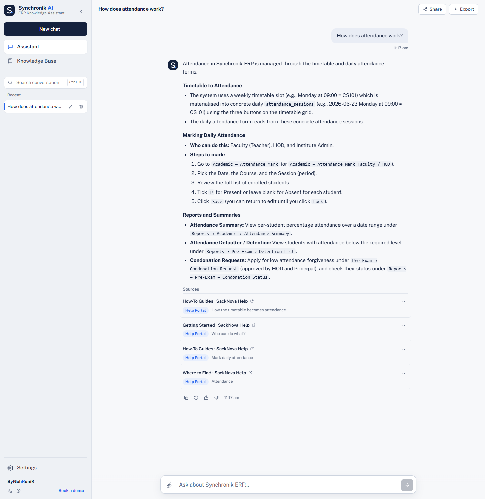
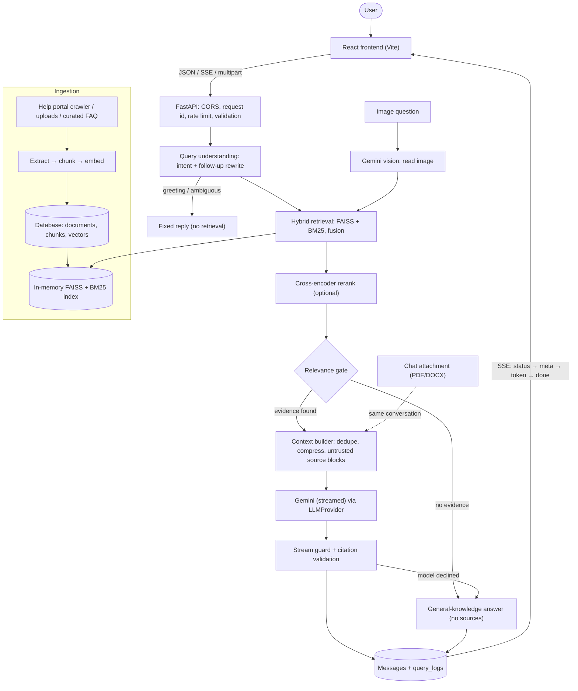
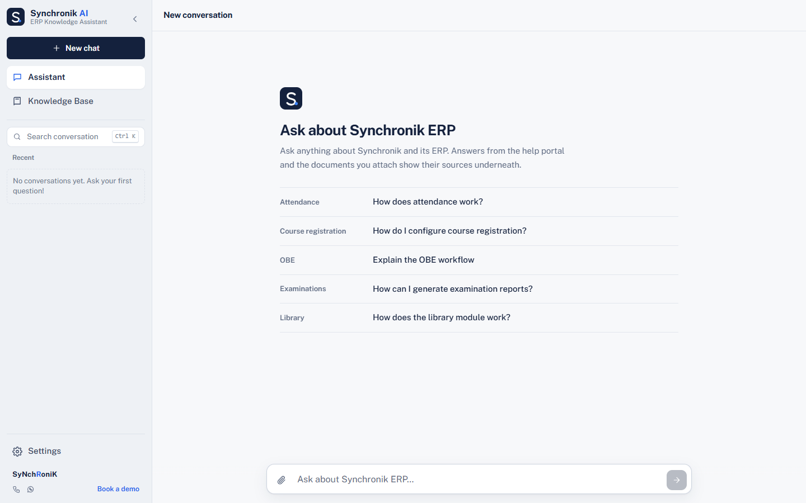
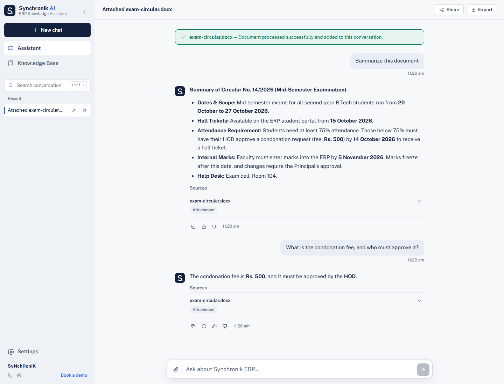
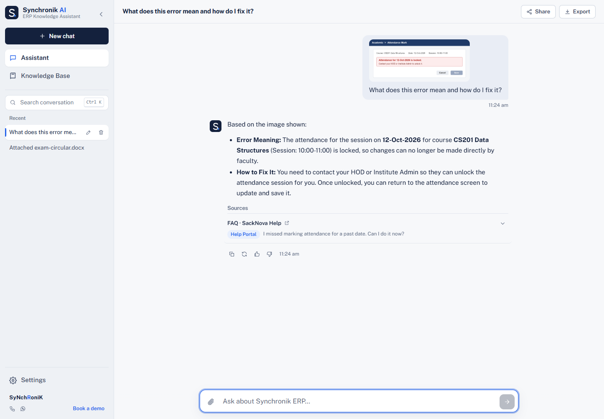
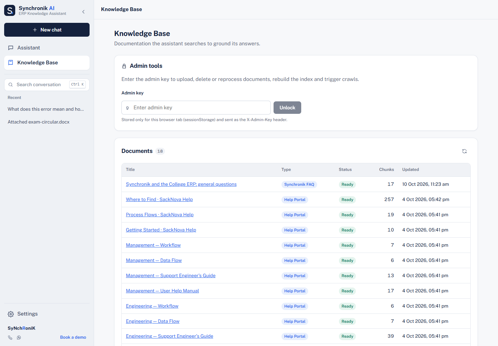

# SynchronikAI

A retrieval-augmented question-answering assistant for **Synchronik ERP**, a college ERP (attendance, examinations,
fees, OBE, library and more). College staff ask questions in plain language; the system retrieves the relevant
passages from Synchronik's help portal and has Google Gemini write an answer grounded in those passages, with the
sources listed under the answer. Users can also attach a PDF/DOCX to a conversation or upload a screenshot and ask
about it.

FastAPI · React 19 · SQLAlchemy (SQLite / PostgreSQL) · FAISS · BM25 · FastEmbed (ONNX) · Google Gemini



> **Status:** runs locally. Backend test suite, frontend lint and production build pass; the Docker image builds
> and starts. The app has **not** been deployed publicly, and the GitHub Actions workflow has not run yet.

**Contents:** [Problem](#problem-and-motivation) · [Features](#key-features) · [Architecture](#architecture) ·
[Technologies](#technologies) · [Request flow](#end-to-end-request-flow) · [Retrieval](#retrieval) ·
[Grounding and citations](#grounded-answers-and-citations) · [Backend and frontend](#backend-and-frontend) ·
[Persistence](#persistence) · [Ingestion](#document-ingestion-and-attachments) · [Security](#security-and-input-validation) ·
[Evaluation](#evaluation) · [Setup](#installation-and-local-setup) · [Configuration](#environment-variables) ·
[Running](#running-the-project) · [Docker](#docker) · [Limitations](#limitations-and-future-improvements)

## Problem and motivation

The Synchronik help portal documents a large ERP in long procedural pages. Staff need the exact menu path and steps
for a task, quickly.

- A general-purpose chatbot invents menu paths and settings that do not exist in this ERP.
- Keyword search misses paraphrased questions; embedding search alone misses exact ERP terms such as "ATKT" or "CO-PO".
- Staff also work from their own circulars and from screenshots of error messages.

SynchronikAI answers from the documentation when the evidence supports it, shows where each answer came from, and
handles questions the documentation does not cover without inventing Synchronik-specific features.

## Key features

- **Hybrid retrieval:** FAISS semantic search + BM25 keyword search, score fusion, optional cross-encoder reranking.
- **Relevance gate:** weak evidence never produces a documentation answer; the question gets a general answer (or is
  declined when `GENERAL_ANSWERS=false`).
- **Grounded generation with validated citations:** Gemini answers only from retrieved passages and cites them as
  `[n]`; invalid citations are removed and only cited sources are returned.
- **Follow-up handling:** follow-up questions are rewritten into standalone queries using the conversation history.
- **Chat attachments (PDF/DOCX):** visible only within their conversation; later questions in that chat are answered
  from the document plus matching help-portal pages.
- **Screenshot questions:** Gemini reads the image, the documentation is searched for what it shows, and the answer
  combines both.
- **Streaming answers** over Server-Sent Events, with Stop, regenerate and retry.
- **Conversations:** persistent history, search, rename, delete, Markdown export, share link, answer feedback.
- **Knowledge-base management:** crawl the help portal, upload/delete/reprocess documents, rebuild the index
  (admin key required); a curated FAQ is loaded at startup.
- **Operations:** health endpoint, structured JSON logs with per-stage timings, admin analytics.

## Architecture



The database is the source of truth: chunk text and embedding vectors are stored there, and the FAISS and BM25
indexes are rebuilt from it at startup (FAISS is also cached to `data/index`). More detail:
[docs/ARCHITECTURE.md](docs/ARCHITECTURE.md).

## Technologies

| Technology | Role in this project |
|---|---|
| Python 3.11, FastAPI, Uvicorn | HTTP API, request validation, streaming responses (`backend/main.py`, `backend/api/routes/`) |
| Pydantic, pydantic-settings | Request/response schemas; all configuration from environment variables (`backend/core/config.py`) |
| SQLAlchemy 2 | ORM over SQLite (local, tests) or PostgreSQL via psycopg2 (planned production) |
| FAISS (`faiss-cpu`) | Exact inner-product search over normalised embeddings (`IndexIDMap2(IndexFlatIP)`) |
| BM25 (own implementation) | Keyword scoring, `k1 = 1.5`, `b = 0.75` (`backend/services/vector_store.py`) |
| FastEmbed + ONNX Runtime | `all-MiniLM-L6-v2` embeddings (384 dimensions) and the `ms-marco-MiniLM-L-6-v2` cross-encoder, without PyTorch |
| Google Gemini (`google-genai`) | `gemini-3.5-flash-lite` for answers and follow-up rewriting; `gemini-3.8-flash` for images (falls back to the text model) |
| pypdf, python-docx, BeautifulSoup, requests, Pillow | PDF/DOCX/HTML extraction, crawling, image validation |
| React 19, Vite, react-markdown | Chat UI, streaming rendering, Markdown answers |
| pytest + httpx TestClient | Backend tests with fake model providers (no network) |
| Docker, GitHub Actions, Render, Vercel | Container image, CI workflow, planned hosting (not deployed) |

## End-to-end request flow

1. `ChatInput` → `useChat.send()` → `streamChat()` (`frontend/src/api/client.js`) posts
   `{"message": "...", "conversation_id": ...}` to `POST /api/chat/stream`.
2. FastAPI assigns a request id, applies the per-IP rate limit (`rate_limit_chat`) and validates the body
   (`ChatRequest`: 1–4,000 characters). `chat_stream()` returns a `StreamingResponse`.
3. `run_events()` (`backend/services/rag_pipeline.py`) stores the user message, loads the last 6 messages
   (≤ 3,000 characters) and calls `analyze()`: rule-based intent (greeting, follow-up, ambiguous, attachment
   question, document question); follow-ups are rewritten by Gemini with a heuristic fallback.
4. `retrieve()` (`backend/services/retrieval.py`) runs hybrid search, optional reranking and the relevance gate.
5. Passing chunks are de-duplicated and compressed into `<source id="n">` blocks marked as untrusted data;
   `compute_confidence()` scores the evidence; a `meta` event is sent.
6. `GeminiProvider.stream()` generates with the system prompt in Gemini's separate `system_instruction`; every
   chunk passes through `StreamGuard` before being sent as a `token` event.
7. Citations are normalised and validated, the answer and its cited sources are saved, a `query_logs` row is
   written, and a final `done` event carries the full response. The UI hides the `[n]` markers and lists the sources.

If the stream endpoint cannot be reached before any event, the frontend falls back to the JSON endpoint
`POST /api/chat`, which runs the same generator.

## Retrieval

### Embeddings and indexing

Documents are split into ~900-character chunks with 150 characters of overlap, keeping the page (PDF) or nearest
heading (DOCX/HTML). Each chunk is embedded with `sentence-transformers/all-MiniLM-L6-v2` through FastEmbed/ONNX
(**384-dimensional**, L2-normalised, so inner product equals cosine similarity). Vectors are stored in the database
with the model name and loaded into FAISS keyed by chunk id, so a document's vectors can be removed or replaced.

### Candidate retrieval and score fusion

- Semantic: top 20 chunks by cosine similarity (FAISS).
- Keyword: top 20 chunks by BM25.
- Only shared knowledge-base chunks and the current conversation's attachments are eligible.
- BM25 scores are normalised by the query's best BM25 score, then
  `fused = 0.65 × cosine + 0.35 × normalised BM25` (`HYBRID_SEMANTIC_WEIGHT`, `HYBRID_KEYWORD_WEIGHT`).
- The top 6 candidates are kept (`RERANK_TOP_N`).

### Optional cross-encoder reranking

With `RERANKER=minilm` (the code default) the best 12 fused candidates are rescored by the
`Xenova/ms-marco-MiniLM-L-6-v2` cross-encoder, which reads query and passage together. It improves ranking and
context precision (see [Evaluation](#evaluation)) but adds about one second per question on CPU and raises peak memory
to about 577 MB, so the planned Render configuration and the local setup run with `RERANKER=none`.

### Confidence gate and unsupported questions

`_apply_gate()` decides whether the evidence is strong enough to answer from the documentation:

- without the reranker: best cosine ≥ `MIN_SEMANTIC_SCORE` (0.30) and at least one supporting chunk;
- with the reranker: best rerank score ≥ `MIN_RERANK_SCORE` (0.10) and best cosine ≥ 0.15; chunks below
  `MIN_CONTEXT_RERANK_SCORE` (0.02) are dropped from the prompt.

If the gate fails, and `GENERAL_ANSWERS=true` (default), the question is answered from Gemini's general knowledge
with a separate prompt that forbids describing Synchronik-specific menus, screens or features and points users to
Synchronik support for undocumented ERP details. Such answers carry intent `general` and no sources. If the
documentation prompt's reply turns out to be the refusal sentence, it is never shown; the question is handed to the
general path. With `GENERAL_ANSWERS=false`, a fixed out-of-scope reply is returned instead.

## Grounded answers and citations

- The system prompt allows answers only from the `<sources>` block and requires a `[n]` citation per factual sentence.
- Retrieved text is treated as untrusted: tag-like markup is neutralised and instruction-like text is flagged.
- `strip_invalid_citations()` removes numbers that do not match a source; `cited_ids()` selects the sources to return.
- `guard_output()` and `StreamGuard` block any answer that would reveal a configured secret or a 60-character window
  of a system prompt; streamed text is released only after it has passed the check.
- An evidence-based confidence score (`0.60 × best relevance + 0.25 × support + 0.15 × agreement`) is returned by the
  API and stored for analytics; it is not displayed in the UI.

## Backend and frontend

**Backend** (`backend/`): `main.py` (app factory, startup, error handlers), `core/` (settings, errors, JSON logging,
security), `api/` (schemas and routes), `services/` (RAG pipeline, retrieval, vector store, embeddings, reranker,
context builder, Gemini provider, conversations, image Q&A, ingestion, jobs, analytics), `db/` (models and sessions),
`crawler/`, `knowledge/` (curated FAQ), `evaluation/`, `tests/`.

**Frontend** (`frontend/src/`): `api/client.js` holds all network code (fetch + JSON, an SSE reader for streamed
answers, XHR uploads with progress); `hooks/useChat.js` manages message state, streaming, Stop, retry and regenerate;
components render the chat, sources, sidebar, Knowledge Base page and settings.

Main endpoints (full list in [docs/API.md](docs/API.md)):

| Endpoint | Purpose |
|---|---|
| `POST /api/chat/stream`, `POST /api/chat` | Ask a question (SSE stream or JSON) |
| `POST /api/chat/regenerate[/stream]` | Replace the last answer |
| `POST /api/chat/attachments`, `POST /api/chat/image` | Attach a document; ask about an image |
| `/api/conversations[/{id}[/export]]` | List, read, rename, delete, export conversations |
| `POST /api/feedback` | Rate an answer |
| `GET /api/documents`, `GET /api/search` | List knowledge-base documents; retrieval-only search |
| `/api/documents` (POST/DELETE/reprocess), `/api/admin/*` | Admin: uploads, crawl, reindex, jobs, stats, analytics |
| `GET /api/health` | Database, index, model and embedding status |

## Persistence

SQLAlchemy models (`backend/db/models.py`): `kb_documents`, `kb_chunks` (text + embedding bytes + model name),
`conversations`, `messages` (with stored sources, confidence and metadata), `message_feedback`, `query_logs`
(per-question timings, intent, scores) and `jobs` (crawl/reindex status).

- **SQLite** (`DATABASE_URL=sqlite:///./data/synchronik.db`) for local development and tests.
- **PostgreSQL** (psycopg2) for production; `postgres://` and `postgresql://` URLs are converted to the installed
  driver. New columns are added by `init_db()`; there is no Alembic migration history.

## Document ingestion and attachments

One pipeline (`backend/services/ingestion.py`) serves the crawler, admin uploads, chat attachments and the curated FAQ:
extract (`document_processing.py`: PDF by page, DOCX by heading with tables, HTML split on h1–h3 with navigation
removed) → chunk (`chunking.py`) → embed → store → add to the live index. Document status moves
`pending → processing → ready | failed`. Crawled pages whose content hash has not changed are skipped.

The crawler (`backend/crawler/crawler.py`) follows only allow-listed hosts, respects `robots.txt`, waits 1 s between
requests, retries 429/5xx with backoff, identifies itself with its own user agent and stops at 200 pages. Admin crawls
and reindexing run on a single background worker thread with their status stored in `jobs`.

**Attachments** are stored with the conversation id and filtered out of every other conversation's retrieval. In that
conversation, documents up to 24,000 characters are sent to the model whole; longer documents contribute their
opening plus the best-matching passages (up to 14,000 characters), together with up to four matching help-portal chunks
unless the question is explicitly about the document. **Images** (`backend/services/image_qa.py`) are validated with
Pillow, read by the vision model, used as a retrieval query, and answered with the image plus matching documentation.

## Security and input validation

| Area | Implementation |
|---|---|
| Secrets | Read only from environment variables; `.env` is git-ignored; the health endpoint never returns values |
| Admin endpoints | `X-Admin-Key` header compared with `hmac.compare_digest`; admin disabled when no key is configured |
| Rate limiting | In-process sliding window per client IP: 30 chat and 10 upload requests per minute |
| Request validation | Pydantic schemas; one error envelope `{"error": {"code", "message", "request_id"}}` |
| Uploads | Size caps (20 MB documents, 8 MB images), type detected from magic bytes, zip-bomb guard, Pillow verification, sanitised display names, processed in memory |
| Prompt injection | Separate system instruction, untrusted source blocks, markup neutralisation, injection flagging |
| Output | Stream guard against secret or system-prompt leaks |
| HTTP | Explicit CORS allow-list, `X-Content-Type-Options: nosniff`, `Referrer-Policy: no-referrer`, `/docs` hidden in production |
| Logs | Questions logged as a hash and length (the `query_logs` table stores the question text) |

There are no user accounts: conversation endpoints are not authenticated (see [Limitations](#limitations-and-future-improvements)).

## Evaluation

### Setup

Retrieval is evaluated with `backend/evaluation/run.py` against hand-labelled answer locations (URL fragment +
phrase). It compares four configurations on the same corpus: **FAISS** only, **BM25** only, **Hybrid** (fusion) and
**Hybrid + reranking**. No language model is called during retrieval evaluation.

| Set | File | Queries | Use |
|---|---|---:|---|
| Development | `backend/evaluation/datasets/*.jsonl` | 92 (71 answerable, 21 unanswerable) | Used while tuning thresholds |
| Held-out | `backend/evaluation/heldout/heldout.jsonl` | 20 (15 answerable, 5 unanswerable) | Not used for tuning |

**Metrics**

- **Recall@5:** the share of a query's labelled answer locations found among the top five retrieved chunks.
- **MRR** (mean reciprocal rank): how highly the first relevant result is ranked; 1.0 means it is always first.
- **Context precision:** the share of chunks selected for the prompt that match a labelled answer location.
- **Gate accuracy:** the share of queries where the gate behaves as defined by the evaluation (answerable queries
  pass the gate; unanswerable queries do not). It is a retrieval-decision metric, **not** end-to-end answer accuracy.

### Results: development set (92 queries)

Recorded in [`backend/evaluation/reports/latest.md`](backend/evaluation/reports/latest.md) (corpus: 17 help-portal
documents, 714 chunks; k = 5):

| Retrieval configuration | Recall@5 | MRR | Context precision | Gate accuracy | Retrieval latency |
|---|---:|---:|---:|---:|---:|
| FAISS | 0.817 | 0.927 | 0.474 | 0.880 | ~10 ms |
| BM25 | 0.756 | 0.850 | 0.434 | 0.804 | ~3 ms |
| Hybrid | 0.810 | 0.916 | 0.480 | 0.891 | ~10 ms |
| Hybrid + reranking | 0.831 | 0.935 | 0.590 | 0.989 | ~1.0–1.2 s |

Latency is retrieval only (p50 9.4 / 2.3 / 10.3 / 952.5 ms; p95 of the reranking configuration 1,210.9 ms), measured
on a Windows laptop CPU, and excludes Gemini generation time. In the reranking configuration the cross-encoder accounts
for almost all of it (p50 931.5 ms).

### Results: held-out set (20 queries)

Recorded in [`backend/evaluation/reports/heldout_latest.md`](backend/evaluation/reports/heldout_latest.md)
(same 17-document corpus):

| Retrieval configuration | Recall@5 | MRR | Context precision | Gate accuracy |
|---|---:|---:|---:|---:|
| FAISS | 1.000 | 0.900 | 0.420 | 0.90 |
| BM25 | 1.000 | 0.763 | 0.440 | 0.85 |
| Hybrid | 1.000 | 0.900 | 0.473 | 0.90 |
| Hybrid + reranking | 1.000 | 0.933 | 0.492 | 0.95 |

### Re-run after adding the curated FAQ (current knowledge base)

The knowledge base later gained a curated FAQ document (18 documents, 733 chunks). The same evaluation was re-run
without changing the labels and recorded separately in
[`backend/evaluation/reports/experiments/e4-faq-added/`](backend/evaluation/reports/experiments/e4-faq-added/):

| Configuration (18 documents) | Dev Recall@5 | Dev MRR | Dev context precision | Dev gate accuracy | Held-out MRR | Held-out gate accuracy |
|---|---:|---:|---:|---:|---:|---:|
| FAISS | 0.800 | 0.898 | 0.462 | 0.870 | 0.900 | 0.85 |
| BM25 | 0.756 | 0.836 | 0.434 | 0.804 | 0.750 | 0.85 |
| Hybrid (**configuration used locally and planned for deployment**) | 0.810 | 0.902 | 0.483 | 0.880 | 0.889 | 0.85 |
| Hybrid + reranking | 0.811 | 0.920 | 0.570 | 0.957 | 0.922 | 0.90 |

The drop is partly a labelling artefact: some questions labelled "unanswerable" (for example biometric devices) are
now answered correctly from the FAQ, which the gate-accuracy metric counts as an error. See
[docs/EVALUATION.md](docs/EVALUATION.md) for the per-type analysis and the other recorded experiments.

### Answer-quality evaluation

A separate 23-item evaluation runs questions through the real pipeline with Gemini
(`backend/evaluation/answers.py`; report:
[`answers_20261010-103545_rescored.md`](backend/evaluation/reports/answers/answers_20261010-103545_rescored.md)).
Run configuration: `gemini-3.5-flash-lite`, `RERANKER=none`, `GENERAL_ANSWERS=true`, 18-document knowledge base,
2026-10-10.

| Measure | Result |
|---|---|
| Items | 23: 18 answerable, 5 not answerable from the documentation |
| Answerable questions answered from the documentation | 18 / 18 |
| Mean key-fact coverage | 0.924 |
| Answers containing all key facts | 15 / 18 |
| Citations pointing to a returned source | 18 / 18 scored answers |
| Unanswerable items handled correctly | 4 / 4 scored in the main run; the 5th hit a transient Gemini error (excerpt fallback) and was handled correctly when retried alone ([retry report](backend/evaluation/reports/answers/answers_20261010-103702.md)) |
| Secret / system-prompt leaks | 0 |
| LLM judge (supplementary) | 18 / 18 documentation answers rated correct |

Key facts are matched by deterministic string rules; the LLM judge uses a model from the same family and is reported
only as a supplementary signal, not as an independent evaluation. Reference answers were drafted from quoted sources
and are pending human review (review sheets are in `backend/evaluation/reports/answers/`).

### Caveats

- The development set has 92 developer-written queries and was used during tuning.
- The held-out set has only 20 developer-written queries. It is not a large, independently annotated benchmark, and
  its perfect Recall@5 mostly reflects that most held-out questions have a single labelled location; it should not be
  read as general retrieval accuracy.
- Labels and reference answers have not been independently reviewed by a human.
- Gate accuracy measures the retrieval decision, not end-to-end chatbot accuracy: 0.989 is **not** "98.9% answer
  accuracy".
- The answer-quality evaluation is small and its model-based judge is not independent.
- Some labels predate the curated FAQ and are now out of date.
- Retrieval latency excludes Gemini generation.

### What was checked, and how

| Kind of check | How | Result |
|---|---|---|
| Automated backend tests | `pytest` (fake Gemini, fake embedder and reranker, temporary databases) | 89 tests: 88 passed, 1 skipped in a fresh checkout (2026-10-10). The skipped test needs a locally crawled database; the suite before the latest test was 88/88 on the development machine |
| Frontend | `npm run lint`, `npm run build` | Pass |
| Retrieval evaluation | `python -m backend.evaluation.run` | Tables above |
| Answer-quality evaluation | `python -m backend.evaluation.answers --judge` | Table above |
| Live Gemini checks | Manual questions against the running app (streaming, follow-ups, attachments, images, quota fallback) | Recorded in [docs/TEST_MATRIX.md](docs/TEST_MATRIX.md) |
| Manual UI checks | Browser checks of the main flows and layouts | Recorded in docs/TEST_MATRIX.md |
| Docker / PostgreSQL rehearsal | Production image against PostgreSQL 16 locally (2026-10-09) | Recorded in [docs/DEPLOYMENT.md](docs/DEPLOYMENT.md); the image was rebuilt and started again with SQLite on 2026-10-10 |
| CI (GitHub Actions) | `.github/workflows/ci.yml`: tests on SQLite and PostgreSQL, frontend lint and build | Not run yet |

## Installation and local setup

**Prerequisites:** Python 3.11, Node.js 20+ (CI uses 22), Git. A Gemini API key is needed for generated answers.

Windows (PowerShell), from the repository root:

```powershell
python -m venv .venv
.venv\Scripts\Activate.ps1
pip install -r backend/requirements.txt -r backend/requirements-dev.txt
Copy-Item .env.example .env          # then fill in the REQUIRED values
New-Item -ItemType Directory -Force data | Out-Null

cd frontend
npm ci
Set-Content .env.local "VITE_API_BASE_URL=http://127.0.0.1:8000"
cd ..
```

macOS/Linux: `python3 -m venv .venv`, `source .venv/bin/activate`, `cp .env.example .env`, `mkdir -p data`.

The first backend start downloads the embedding and reranker models (about 175 MB) into `data/models`.

## Environment variables

All settings are documented in [.env.example](.env.example). The required ones:

| Variable | Purpose | If missing |
|---|---|---|
| `DATABASE_URL` | `sqlite:///./data/synchronik.db` locally, or a PostgreSQL URL | Falls back to PostgreSQL on localhost |
| `GEMINI_API_KEY` | Enables generated answers and image questions | Answers are documentation excerpts; image questions return 503 |
| `ADMIN_API_KEY` | Enables admin endpoints (`X-Admin-Key`) | Admin endpoints are disabled |

When a required variable is missing, the server still starts, logs a `config_incomplete` warning naming the variable
and its effect, and `GET /api/health` reports `degraded` when the model key is missing. Other useful settings:
`CORS_ORIGINS`, `RERANKER` (`minilm` or `none`), `GENERAL_ANSWERS`, `MIN_SEMANTIC_SCORE`, `MIN_RERANK_SCORE`,
`HYBRID_SEMANTIC_WEIGHT`, `HYBRID_KEYWORD_WEIGHT`, `ENVIRONMENT=production`. The frontend reads only
`VITE_API_BASE_URL`; every `VITE_*` value is public, so never put secrets there.

## Running the project

```powershell
# Backend (repository root, virtual environment active)
python -m backend.crawler.crawler help_portal      # load the help portal; re-runs skip unchanged pages
uvicorn backend.main:app --reload                   # http://127.0.0.1:8000  (API docs: /docs)
curl.exe http://127.0.0.1:8000/api/health           # status: healthy | degraded | unhealthy

# Frontend (second terminal)
cd frontend
npm run dev                                         # http://localhost:5173
```

```powershell
# Tests
pytest                                              # backend suite, no network or API key needed
cd frontend; npm run lint; $env:VITE_API_BASE_URL="https://api.example.com"; npm run build

# Retrieval evaluation (needs the crawled knowledge base; no API key)
python -m backend.evaluation.run                                  # development set → reports/latest.*
python -m backend.evaluation.run --split heldout                  # held-out set → reports/heldout_latest.*
python -m backend.evaluation.run --tag my-experiment              # writes reports/experiments/my-experiment/
python -m backend.evaluation.run --check-labels                   # verify labels exist in the corpus

# Answer-quality evaluation (needs GEMINI_API_KEY; ~2 requests per item)
python -m backend.evaluation.answers --check                      # verify evidence quotes, no LLM calls
python -m backend.evaluation.answers --judge                      # full run with the supplementary judge
python -m backend.evaluation.answers --rescore <saved-run.json>   # recompute metrics without LLM calls

# Diagnostics
python -m backend.evaluation.diagnose misses                      # also: corpus, query, pool, scores
```

Note: a plain `python -m backend.evaluation.run` overwrites `reports/latest.*`; use `--tag` to keep the recorded
reports unchanged. To run the backend tests against PostgreSQL, set `TEST_DATABASE_URL` to a test database URL.

## Docker

The `Dockerfile` builds the backend image (Python 3.11-slim, non-root user, ONNX models baked in, Uvicorn on `$PORT`):

```powershell
docker build -t synchronikai-api .
docker run -p 8000:8000 --env-file .env synchronikai-api
```

Inside the container, use a PostgreSQL URL or a SQLite path such as `sqlite:////app/data/synchronik.db`.
`render.yaml` describes the planned Render deployment (API + PostgreSQL, `RERANKER=none`, health check
`/api/health`) and `frontend/vercel.json` the planned Vercel frontend; see [docs/DEPLOYMENT.md](docs/DEPLOYMENT.md).
There is no Docker Compose file.

## Limitations and future improvements

**Current limitations**

- Not deployed; evaluation sets are small and developer-written (see [Caveats](#caveats)).
- No user accounts: anyone who knows a conversation id can read, rename or delete it, and the conversation list is
  shared.
- Single-instance design: rate limits, the FAISS/BM25 index and the job queue live in process memory.
- `query_logs` records general answers as `out_of_scope`, so admin analytics count them as refusals; image questions
  are not written to `query_logs`.
- The old-client alias `POST /chat` is not rate-limited; unhandled 500/503 errors return `request_id: null`.
- The reranker is off in the deployed configuration because of memory (577 MB peak vs a 512 MB host).
- Gemini's free tier allows only a small number of requests per day; beyond it users get documentation excerpts.
- No OCR for scanned PDFs; no frontend unit tests; no Alembic migrations.

**Possible improvements**

- Authentication and per-user conversation ownership.
- Shared rate limiting and vector storage (for example Redis and pgvector) for multiple instances.
- Log the final intent in `query_logs`, log image questions, and rate-limit the legacy alias.
- A larger, independently reviewed evaluation set.

## Screenshots

| | |
|---|---|
|  |  |
| Home screen with suggested questions | An attached DOCX circular summarised, then queried |
|  |  |
| A screenshot of an error explained with the matching help page | Knowledge Base page (public view) |

Captured from the application running locally; the circular and the error image are fictional demo files
([details](docs/screenshots/README.md)).

## License and attribution

No license has been chosen yet; until a `LICENSE` file is added, the code is not licensed for reuse. Third-party
libraries and the downloaded models are used under their own licenses. The help-portal content, the curated FAQ text
and the Synchronik name belong to Synchronik; the repository contains the curated FAQ and evaluation datasets that
quote short passages of that content, not the crawled pages.

**Author:** Arpita Khobragade
