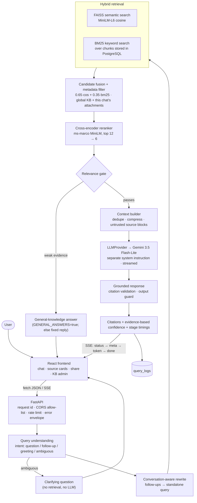
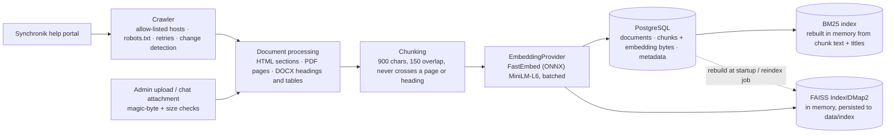

# Architecture

## Query path

## Ingestion path

## Components

| Component | Purpose | Code |
|---|---|---|
| React frontend | Chat UX, SSE parsing, source cards (citation markers hidden), share link, KB admin | `frontend/src` |
| FastAPI | Validation (Pydantic), error envelope, request ids, CORS, rate limiting, admin auth | `backend/main.py`, `backend/api` |
| Query understanding | Rule-based intents, which are cheap and testable. Ambiguous pronoun-only questions with no history get a clarification request | `services/query_understanding.py` |
| Query rewrite | Follow-ups rewritten with an LLM, falling back to a heuristic, because embeddings of "it" match nothing | same |
| FAISS semantic search | Paraphrase-tolerant recall. Cosine similarity over normalized MiniLM vectors | `services/vector_store.py` |
| BM25 keyword search | Exact ERP terms (OBE, TC, CO-PO). In-process, so the same code runs on SQLite and PostgreSQL | same |
| Fusion + filter | Weighted score fusion. Attachment chunks are visible only inside their own conversation | `services/retrieval.py` |
| Cross-encoder reranker | Scores (query, passage) pairs jointly. Its probability drives the refuse/answer gate | `services/reranker.py` |
| Relevance gate | Best chunk below threshold → refuse without calling the LLM. A separate, lower bar decides which chunks stay in the context | `services/retrieval.py` |
| Context builder | Removes near-duplicates, compresses sentences to a budget, wraps each chunk as untrusted `<source id=n>` data, neutralizes tags, flags injection phrasing | `services/context_builder.py` |
| LLMProvider | Interface with one implementation, `GeminiProvider`. The pipeline only calls `stream()`/`generate()`/`describe_image()` | `services/llm.py` |
| Grounding checks | Removes invalid `[n]`, returns only cited sources, detects refusals, and an output guard blocks secret or system-prompt echoes | `services/context_builder.py` |
| Confidence | `0.60·top relevance + 0.25·support + 0.15·agreement`, computed from evidence only | `services/confidence.py` |
| Observability | JSON logs (query hash, never the text), `query_logs` rows with per-stage timings, analytics endpoint | `core/logging.py`, `services/analytics.py` |
| Jobs | Single worker thread for crawl and reindex, with status stored in `jobs` | `services/jobs.py` |

## Why PostgreSQL and FAISS

- PostgreSQL is the source of truth: text, metadata, embedding bytes, conversations, feedback and logs, all transactional and backed up.
- FAISS is a derived cache. Exact search over about 700–50k vectors takes milliseconds, and it can be rebuilt from PostgreSQL at any time (`python -m backend.scripts.reindex`).
- `VectorStore` is an interface, so pgvector or a hosted vector database can replace `FaissStore` without changing retrieval code.

## Concurrency

- Chat handlers are synchronous `def`s and generators. FastAPI/Starlette runs them in a worker thread pool, so CPU-heavy embedding and reranking never blocks the event loop.
- FAISS add/remove/search share an `RLock`.
- The BM25 index is rebuilt into a new object and swapped in by reference, so searches never see a half-built index.
- ONNX Runtime inference sessions are safe to call from several threads.
- FAISS is pinned to one OpenMP thread: its spin-waiting slowed ONNX inference considerably in the same process (the code comment records about 10×).
- Each request gets its own short-lived SQLAlchemy session through `session_scope()`.
- Index mutations go through the single job worker or synchronous ingestion calls.

## Scaling path

| Concern | Today | Next step |
|---|---|---|
| Vectors | FAISS flat index, one per API process | pgvector, or an IVF/HNSW index at more than about 500k chunks |
| Keyword search | In-memory BM25, rebuilt on change | PostgreSQL `tsvector` with a GIN index |
| Reranker | CPU, about 1 s for 12 pairs on a laptop | Smaller distilled model, GPU, or a hosted rerank API |
| Rate limiting | In-process | Redis |
| Jobs | One thread | Celery/RQ or Cloud Tasks |
| Multi-tenancy | Single tenant | `tenant_id` on documents and conversations, used in the retrieval filter |
