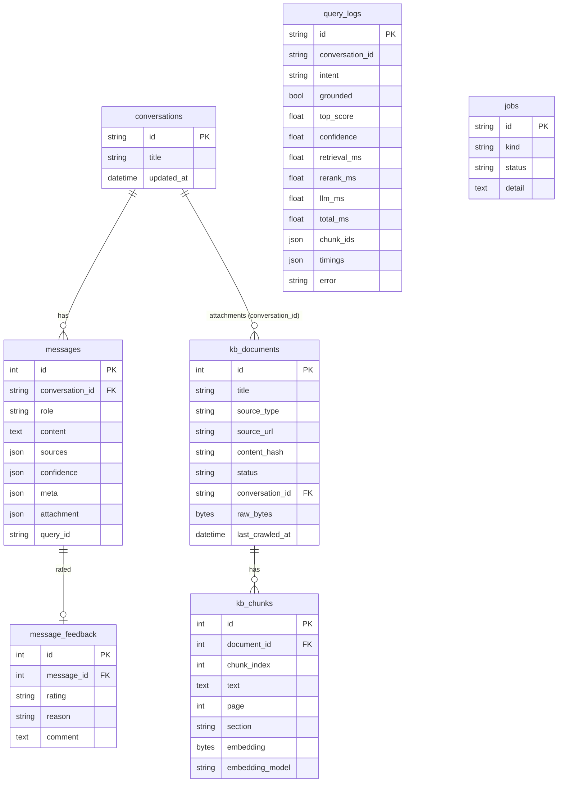

# Database

## Setup (PostgreSQL)

```bash
createdb synchronik_ai
# .env
DATABASE_URL=postgresql+psycopg2://postgres:<password>@localhost:5432/synchronik_ai
```

Tables are created on API startup (`Base.metadata.create_all`, idempotent). For local
experiments without PostgreSQL, `DATABASE_URL=sqlite:///./data/synchronik.db` works too
(tests use SQLite).

## Schema



* There is no users table: admin access is a single `ADMIN_API_KEY` header, and end users are anonymous per conversation.
* Evaluation data is **not** in the database. Datasets and reports are version-controlled JSONL/JSON under `backend/evaluation/`.
* `query_logs.timings` holds per-stage milliseconds (embed, semantic, keyword, fusion, rerank, context, llm_first_token, llm, total). It is added to existing databases by the idempotent `ALTER TABLE` in `init_db()`.
* `kb_documents.conversation_id IS NULL` → global knowledge base; otherwise a private chat attachment.
* `content_hash` (SHA-256 of extracted text) drives crawler change detection.
* `kb_chunks.embedding` is float32 bytes + the model name, so a model change is detected and
  stale vectors are excluded from the index until re-embedded (`/reprocess`).

## Schema changes

Additive column changes are applied by `init_db()` (`_ADDED_COLUMNS`). Anything beyond that
(renames, type changes) would need Alembic, which is the intended next step.

PostgreSQL compatibility: the ORM uses only portable types (JSON, LargeBinary→`bytea`,
timezone-aware DateTime). NUL bytes are stripped from extracted text because PostgreSQL
rejects them. CI runs the full test suite against a PostgreSQL 16 container
(`.github/workflows/ci.yml`). **That CI job has not run yet.** It runs on the first push to GitHub.
